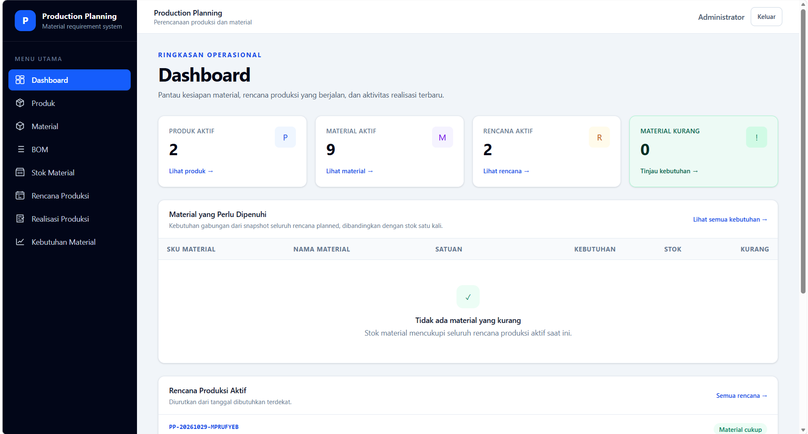
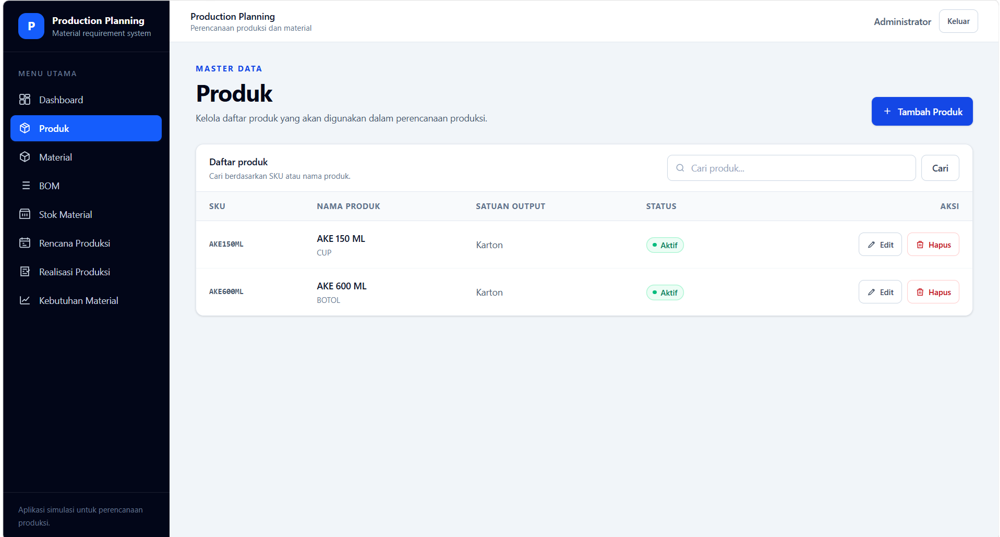
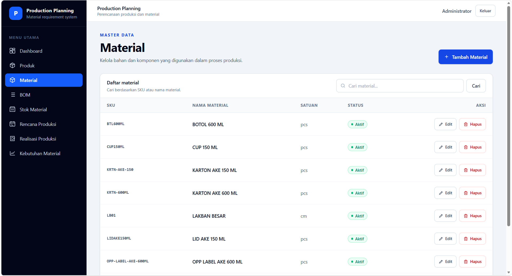

# Production Planning & Material Requirement Planning Dashboard

A portfolio project that simulates ERP workflows for a fictional mineral water manufacturer. It demonstrates how product BOMs, material inventory, production plans, and production realizations work together in a small manufacturing application.

This project is a standalone simulation. It is not connected to a real company's ERP or production system.

## Features

- **Authentication** — session-based login and logout for application users.
- **Dashboard** — database-backed summary of active products and materials, planned production, material shortages, upcoming plans, and recent realizations.
- **Product Management** — create, view, update, search, and manage active products.
- **Material Management** — create, view, update, search, and manage active materials.
- **Bill of Materials (BOM)** — define the material quantities required for each product.
- **Material Inventory** — view balances, receive materials, record stock adjustments, and configure reorder levels with stock movement history.
- **Production Planning** — create production plans that retain a snapshot of the BOM used at planning time.
- **Material Requirements Planning (MRP)** — aggregate material requirements for planned production and compare them with current stock to identify shortages.
- **Production Realization** — create and post production realizations, recording material consumption and finished goods output.
- **Finished Goods Inventory** — maintain finished goods balances and production output movement history.

## Business Workflow

```text
Products → BOM → Material Inventory → Production Planning → MRP → Production Realization → Finished Goods Inventory
```

Products and their BOMs define what can be manufactured. Each production plan stores a BOM snapshot, so later master-data changes do not silently alter an existing plan. MRP aggregates requirements from plans with a planned status and compares them with current inventory. Posting a production realization records material consumption and adds the output to finished goods inventory.

## Application Screenshots

### Dashboard


### Product Management


### Material Management


### Bill of Materials


### Production Planning


### Material Requirements Planning


## Technology Stack

- PHP 8.2+
- Laravel 12
- MySQL
- Blade templates
- Tailwind CSS 4
- Vite
- PHPUnit

## Installation

### Requirements

- PHP 8.2 or later with the required Laravel PHP extensions
- Composer
- MySQL or MariaDB
- Node.js and npm

### Set up a development database

1. Clone the repository and install the PHP dependencies:

   ```bash
   composer install
   ```

2. Create a local environment file from the example:

   ```bash
   cp .env.example .env
   ```

   On Windows PowerShell, use:

   ```powershell
   Copy-Item .env.example .env
   ```

3. Create a MySQL database for development. The current `.env.example` uses `erp` as the database name. In phpMyAdmin, open **Databases**, enter `erp`, select the `utf8mb4_unicode_ci` collation, and create the database.

4. Configure the database settings in your new `.env` file. For example:

   ```dotenv
   APP_ENV=local
   DB_CONNECTION=mysql
   DB_HOST=127.0.0.1
   DB_PORT=3306
   DB_DATABASE=erp
   DB_USERNAME=root
   DB_PASSWORD=
   ```

   Use the MySQL username and password configured on your machine. Never commit `.env`.

5. Generate the application key:

   ```bash
   php artisan key:generate
   ```

6. Confirm that the connection is set to the intended development database before applying migrations. Then run:

   ```bash
   php artisan migrate
   ```

7. Install frontend dependencies and build the assets:

   ```bash
   npm install
   npm run build
   ```

8. Start the Laravel development server:

   ```bash
   php artisan serve
   ```

   For frontend development with Vite, run `npm run dev` in a separate terminal.

## Demo Database and Seeder

Keep the development database (`erp`) separate from the portfolio demo database (`erp_demo`). The demo seeder does not create databases automatically. Create `erp_demo` manually in phpMyAdmin:

1. Open phpMyAdmin and connect to your local MySQL or MariaDB server.
2. Select **Databases**.
3. Enter `erp_demo`, select the `utf8mb4_unicode_ci` collation, and click **Create**.
4. Keep your development `.env` configured to use `erp`. For demo setup, temporarily select `erp_demo` for the current terminal process as described below.

The demo seeder has safety guards: it only runs with `APP_ENV=local`, the MySQL driver, and the active database name `erp_demo`. It rejects `erp` and other databases before making changes. It also checks demo identifiers and existing demo stock history before writing. It does not delete data, reset inventory, or overwrite an existing account.

Run the demo database migrations and seeder only after creating `erp_demo` and verifying the active connection. Open a dedicated PowerShell terminal for these commands. The environment-variable overrides below apply only to that terminal process; they do not edit `.env` or persist after the process ends. The script also restores any values that were already set in that terminal:

```powershell
$names = @("APP_ENV", "DB_CONNECTION", "DB_DATABASE", "DEMO_USER_PASSWORD")
$previous = @{}
foreach ($name in $names) {
    $previous[$name] = [Environment]::GetEnvironmentVariable($name, "Process")
}

$pointer = [IntPtr]::Zero
try {
    $env:APP_ENV = "local"
    $env:DB_CONNECTION = "mysql"
    $env:DB_DATABASE = "erp_demo"

    php artisan migrate
    if ($LASTEXITCODE -ne 0) {
        throw "Demo database migration failed; seeding was not started."
    }

    $secret = Read-Host "Demo account password" -AsSecureString
    $pointer = [Runtime.InteropServices.Marshal]::SecureStringToBSTR($secret)
    $env:DEMO_USER_PASSWORD = [Runtime.InteropServices.Marshal]::PtrToStringBSTR($pointer)

    php artisan db:seed --class=DemoDataSeeder
    if ($LASTEXITCODE -ne 0) {
        throw "Demo seeding failed."
    }
} finally {
    if ($pointer -ne [IntPtr]::Zero) {
        [Runtime.InteropServices.Marshal]::ZeroFreeBSTR($pointer)
    }
    Remove-Variable secret, pointer -ErrorAction SilentlyContinue

    foreach ($name in $names) {
        if ($null -eq $previous[$name]) {
            Remove-Item "Env:$name" -ErrorAction SilentlyContinue
        } else {
            Set-Item "Env:$name" $previous[$name]
        }
    }
}
```

The database host and credentials are still read from `.env`; only the process-level environment variables shown above override settings from that file for these Artisan commands. If you use another shell, apply equivalent temporary overrides and restore or clear them afterward.

The demo data includes four fictional products, ten materials, BOMs, opening stock and stock movements, four production plans, and one completed production realization. A login account is created only when `APP_ENV=local` and `DEMO_USER_PASSWORD` is provided. Its email is `demo@example.com`; this project does not define or publish a default password. If the account already exists, the seeder leaves it unchanged.

Do not point the demo seeder at a development or production database. Do not commit `DEMO_USER_PASSWORD` or share it as a repository credential.

## Automated Tests

Run the test suite with:

```bash
php artisan test
```

The PHPUnit configuration uses an in-memory SQLite database for automated tests; tests do not require the MySQL demo database.

## Disclaimer

All products, materials, plans, stock balances, and transactions in this application are fictional sample data for demonstration and learning purposes. They do not represent a real manufacturer, business, or production record.
